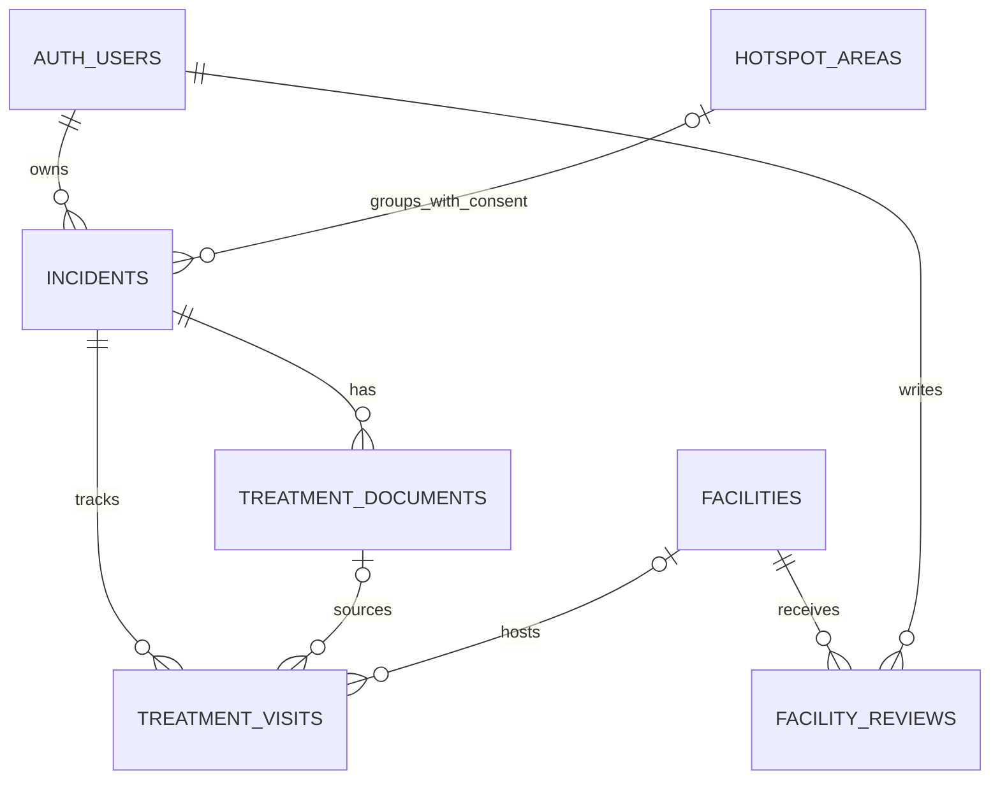

# PASADA: LIGTAS — module plan

Updated 12 November 2026. This replaces the earlier MySQL/device-cookie architecture. The screenshot supplies the module requirements; the repeated “public or public” is interpreted as **public or private**. No existing application code was present when this plan was made.

## What we are building

A mobile web app for Filipino animal-bite patients and caregivers to record an incident, understand a treatment card using Lumen, track clinic visits for that incident, find care, and view coarse community bite reports.

**One incident is the parent of its documents and visits.** Two bites create two incidents. Returning to a clinic creates another visit under the same incident. A clinic visit can include several injections; a visit count is not a vaccine-dose count.

## Modules, spliced like the screenshot

### 1. Incident Recording — Josh

- Enter incident date, city/barangay and optional private pin/location notes.
- Select dog/cat/other/unknown; optionally record animal details and the body site.
- Record other relevant notes; a category is copied only if a clinician recorded it.
- List, edit and delete your own incidents.
- Offer a separate, default-off checkbox to contribute to the area-level bite map. Explain what gets shared before enabling it.
- Data: `incidents`. Route: `/incidents` and `/incidents/:id`.
- Done: refreshing preserves the record, another account cannot access it, and deleting it removes its document/visit rows after file cleanup.

### 2. Document Scan & Explanation — Ed

- Start from an incident; upload a JPG/PNG treatment card.
- Lumen OCR reads the card. Show the image and editable text together.
- Lumen AI Chat explains corrected text in Filipino/English; unreadable fields remain unknown.
- User confirms the extracted fields and explicit dates. Never calculate a clinical regimen from an animal, wound category, or previous treatment.
- Data: `treatment_documents` and private `treatment-cards` Storage bucket. Route: `/incidents/:id/documents`.
- Done: one live Lumen request works, a correction changes the explanation, and an unreadable date does not become an appointment.
- The bucket accepts PDF for storage, but PDF scanning is not a promised feature until the actual Lumen integration is tested.

### 3. Bite Tracker — Josh

- Always open within a selected incident. Show its hospital/ABTC visits, planned dates, attendance and treatments as recorded.
- Add an appointment only from an explicit card date or clinic instruction, with user confirmation.
- Mark attendance and undo it; this is self-reported, not a medical completion certificate.
- Show “Needs confirmation” if `schedule_confirmed_at` is null. For confirmed dates, derive today/upcoming/overdue using Asia/Manila; do not store a status that becomes stale tomorrow.
- On missed visits, direct users to the treating clinic. Do not recommend restarting, stopping or changing treatment.
- Data: `treatment_visits`, linked by `incident_id`, with an optional `facility_id` and same-incident `document_id`. Route: `/incidents/:id/tracker`.
- Done: two incidents have separate timelines. Changing a linked card or appointment clears its date confirmation and never silently changes later visits.

### 4. Hospital Maps & Reviews — AJ

- Display published facilities in a list and Leaflet map.
- Filter ownership: public/private/NGO/unknown; filter service type separately: hospital/ABTC/health center.
- Show sourced contact, cost/eligibility notes, verification date, and assistance information. Do not treat accreditation, Malasakit presence, or an old price as a free-care guarantee.
- Only plot confirmed coordinates. Unknown/conflicting locations get a “Call to confirm” message.
- Show published reviews through `get_facility_reviews`; signed-in users can submit one review per facility, edit or delete their own review.
- Reviews start pending; a project administrator moderates through Supabase. Editing a published review returns it to pending. Review text must not contain patient identifiers, treatment cards or personal medical details.
- Data: `facilities`, `facility_reviews`. Route: `/facilities` and `/facilities/:id`.
- Done: published facilities appear, drafts stay hidden, client accounts cannot publish facilities/reviews, and public review output has no author ID.

### 5. Bite Hotspot Map & Location Alerts — AJ

- Call `get_bite_hotspots()` for coarse, opted-in, self-reported bite activity over the last 90 Manila calendar dates, including today.
- Show a curated barangay/area center only after at least five distinct reporting accounts qualify. Display bands `5-9`, `10-19`, `20+`, not exact incident coordinates, account IDs or report dates.
- Use one combined dog/cat/other reporting layer for MVP. Do not add animal/date filters that let viewers narrow an aggregate to a small group.
- No data means “Not enough qualifying reports,” never “No risk.” Reporting accounts are not verified patients; several accounts may belong to one person.
- Ask permission before enabling `navigator.geolocation.watchPosition`. Compare the user's location against the returned approximate circles locally, without saving movement history.
- Show an in-app notice when crossing into a displayed circle. Remember which circles already alerted during this page session to avoid repeated GPS alerts. Denied permission or unavailable GPS leaves the map usable. Discard readings whose accuracy is too poor for the circle.
- Stop the location watcher when the user disables alerts or leaves the map. MVP alerts require the page to be open and active; no closed-app/background geofencing promise.
- Data: `hotspot_areas` + aggregate RPC. No location-alert table is needed. Route: `/community-map`.
- Done: opting out removes a report's contribution, duplicate reports from one account cannot meet the five-account minimum, exact bite pins stay private, and simulated entry/exit produces one appropriate notice.
- This is a bite-report map, **not a map of confirmed rabies or safe/unsafe neighborhoods**. The five-account rule reduces disclosure; it does not guarantee anonymity or remove reporting bias.

### Shared foundation — Ed, with integration by everyone

- Supabase PostgreSQL is the single database. Do not create parallel MySQL tables.
- Supabase Auth supplies identity; no custom passwords or redundant profile table is needed yet. Use recoverable email sign-in for the pilot. Optional anonymous sign-in can help a demo, but losing that session loses access unless upgraded.
- Browser: public/publishable Supabase key + the signed-in user's session; RLS enforces private access. Never put a secret/service-role key or Lumen credentials in the browser.
- PHP is the server-side Lumen relay on the existing XAMPP stack. Verify the caller and incident ownership; do not trust a browser-supplied `user_id`. Prefer the user's token for database operations so RLS still applies.
- Share one Supabase client and the existing page/layout style; use one Leaflet setup for the two map screens. No microservices or heavy framework is required.

## Database relationships

| Table | What belongs here | Access |
|---|---|---|
| `auth.users` | Supabase identity; already exists | Supabase-managed |
| `incidents` | Incident date, animal, private location/medical notes, map opt-in | Owner only |
| `treatment_documents` | Incident link, private file path, OCR, corrected text, explanation, reviewed fields | Same owner and incident |
| `treatment_visits` | Incident link, optional facility/document, explicit appointment, confirmation and attendance | Same owner and incident |
| `facilities` | Sourced hospital/ABTC/health-center directory, ownership and cost notes | Published rows readable; admin writes |
| `facility_reviews` | Rating, service review, moderation status | Owner CRUD; moderated public projection through RPC |
| `hotspot_areas` | Curated approximate area center/radius | Published rows readable; admin writes |

The composite foreign keys intentionally repeat `user_id` on child rows. They prevent attaching a document or visit to somebody else's incident even if the client sends a guessed UUID. The document/visit foreign key also prevents linking a document from a different incident owned by the same user.

## Team handoffs

| Person | Owns | Must hand over |
|---|---|---|
| Ed | Auth, schema/RLS/Storage, Lumen relay and document flow | Shared Supabase initialization, upload path, real OCR/Chat response, error format |
| Josh | Incident form/list/detail and incident-bound tracker | Saved `incident.id`, document/tracker links, date-confirmation UI |
| AJ | Facility list/map/reviews, hotspot map/foreground alerts, sourced seed data | Selected `facility.id`, published clinic records, aggregate map rendering |

Do not build three separate apps. Suggested future code locations are `modules/incidents/`, `modules/documents/`, `modules/tracker/`, `modules/facilities/`, `modules/community-map/` and shared `lib/`. These are ownership boundaries, not scaffolding that must exist before a page works.

## Integration contract

1. Create an incident first. The database defaults `user_id` to `auth.uid()`; the browser does not assign another owner.
2. Generate a document UUID and upload to `treatment-cards/<user-id>/<incident-id>/<document-id>/<random-file-name>`; save that relative path, never a public URL. Use authenticated downloads or short-lived signed URLs. Handle a failed metadata save by removing the uploaded file.
3. Save corrected OCR text first. Source changes clear `ai_explanation`, `reviewed_fields`, `reviewed_at` and linked visit confirmations. Then request a fresh explanation, review it, and save the reviewed fields/time in a separate write. Do not combine a source change with its review confirmation in one update.
4. `reviewed_fields` is a JSON object. Agree on these keys before UI work: `clinic_as_written`, `medicines_as_written` (array of strings), `return_dates` (array of `{date, source_excerpt}`), and `unknown_fields` (array). All are user-reviewed document claims, not AI treatment orders. Validate shape and date/source matches on the server; SQL only checks that the top level is an object.
5. Save only individually confirmed return dates as visits. A changed date/source clears its old confirmation; explicitly reconfirm in a second write. Never notify for an unconfirmed date.
6. Hospital selection returns `facility.id`; manually recorded clinic instructions can exist without a matching directory entry. Record the clinic name in visit `notes` when there is no directory match.
7. Public reviews: `supabase.rpc('get_facility_reviews', {p_facility_id: facilityId})`. Public hotspots: `supabase.rpc('get_bite_hotspots')`. Never fetch raw incident records to construct a public map.

## Build order and checkpoints

| Checkpoint | What must work before proceeding |
|---|---|
| Hours 0–2 | Import schema in the intended empty project; test Auth; agree keys, routes and JSON; get one actual Lumen response |
| Hours 2–10 | Josh saves an incident; Ed completes upload/OCR/review; AJ loads sourced facilities and a shared map |
| Hours 10–22 | Tracker saves under the incident; corrections invalidate old confirmations; published facility list and reviews work |
| Hours 22–32 | Connect opt-in aggregate map; implement permission-aware foreground entry notices; label synthetic demo data |
| Hours 32–40 | Two-account privacy checks, clinic verification, error/mobile/date tests, one full end-to-end run |
| Hours 40–48 | Freeze features, fix blockers, rehearse a three-minute demo and record a backup |

This is a planning assumption, not an instruction to work 48 hours without rest. If the actual event is shorter, keep one city and fewer verified facilities; do not remove user correction or private access.

## Acceptance checklist

- [ ] Real Lumen integration works; no saved sample is presented as a live call.
- [ ] Two accounts cannot read/change each other's incidents, documents, visits or unmoderated reviews.
- [ ] Two incidents retain separate visits; cross-owner and cross-incident links fail.
- [ ] Blank/ambiguous dates remain unresolved; correcting a card or appointment forces confirmation again.
- [ ] Visits show clinic-written instructions; no automated dosing, missed-dose regimen advice or immunity/completion claim.
- [ ] Facility filters distinguish ownership from service type. Cost, stock, hours and transfer eligibility are not invented.
- [ ] Review publication requires an admin; editing removes the review from public output pending another check.
- [ ] Hotspots exclude opted-out, old and future-dated records; fewer than five accounts produces no hotspot output.
- [ ] Geolocation permission denied, low accuracy and an inactive/closed page are explained honestly; no tracking trail is stored.
- [ ] Deleting a record removes its Storage objects through the API before deleting database metadata. Account deletion uses server-side file cleanup too.
- [ ] Test a 360px phone viewport, keyboard labels, upload failure, OCR timeout and malformed Chat output.

## Effectiveness and limits

The focused document-to-follow-up flow remains the main hackathon value. Maps help navigation and community awareness, but do not replace care or establish disease prevalence. Test five adult users/caregivers with synthetic cards: at least four should identify the confirmed return date, explain a recorded term, and find a contact without mistaking unknown cost for free care. Compare against paper-only tasks with matched cards. These are proposed thresholds, not measured outcomes.

Use synthetic/de-identified cards for judging. Obtain an appropriate consent/privacy process before real patient use. No automatic retention job, account deletion job, anti-spam system, official partner endorsement, live clinic stock feed, clinician validation or patient outcome study is implemented by this schema. Decide retention and implement Storage/API cleanup before a public pilot.

## Primary technical references

- [Supabase RLS](https://supabase.com/docs/guides/database/postgres/row-level-security)
- [Supabase Storage access control](https://supabase.com/docs/guides/storage/security/access-control)
- [Private buckets](https://supabase.com/docs/guides/storage/buckets/fundamentals)
- [Supabase anonymous sign-in and recovery limits](https://supabase.com/docs/guides/auth/auth-anonymous)
- [Browser geolocation, secure context and explicit permission](https://developer.mozilla.org/en-US/docs/Web/API/Geolocation/watchPosition) — deploy on HTTPS; test phone access separately from localhost.

For the medical/clinic evidence and proposed Pasig partner, retain the official references in the shared Google Doc. Clinic information must be rechecked before publishing directory rows.
